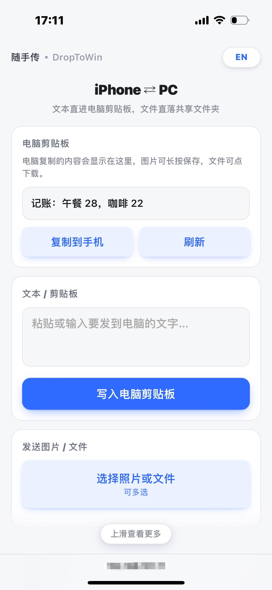
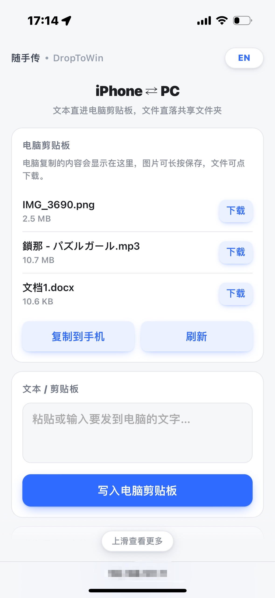
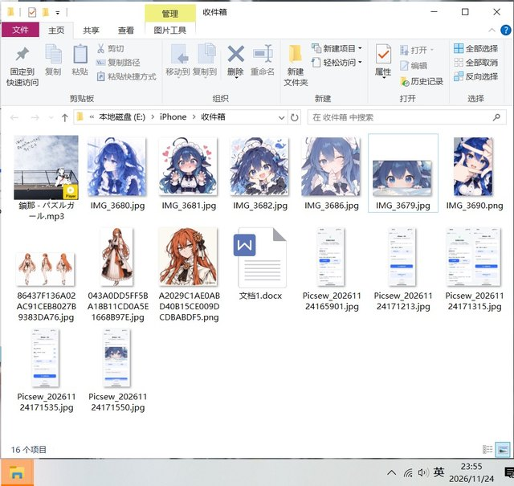
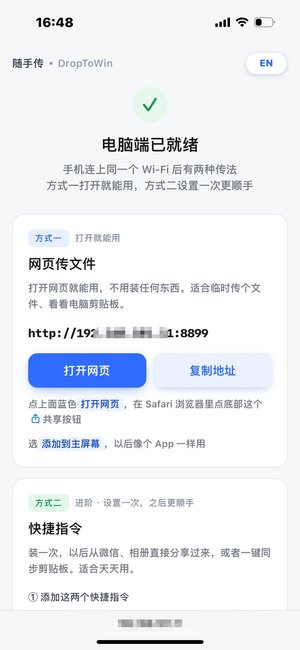
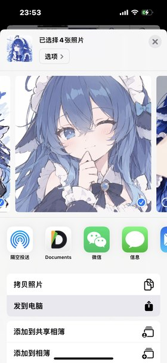

# DropToWin

> Send files, photos and clipboard text between an iPhone and a Windows PC over your local network. No cloud, no account, no app to install on the phone.

[中文](README.md) · [Config example](_tools/config.example.json) · v1.0.0

| Phone web page: open and go | Files copied on the PC, downloadable on the phone |
|---|---|
|  |  |



*Arriving on the PC: into the inbox, Explorer pops up on it*


---

## What it solves

Sending a file through WeChat takes five steps: open the app, find "File Transfer", tap plus, pick the file, send.
This takes three, and you never leave the app you are already in: long-press a file → Share → Send to PC.

Three things it does:

| Ability | Notes |
|---|---|
| **Browser transfer** | Open one URL on the phone to send or receive files and read the PC clipboard. Nothing to install |
| **Shortcuts integration** | From WeChat, Photos, or any share sheet, send straight to the PC |
| **Two-way clipboard** | Push phone text to the PC, pull PC text back. Images and copied files show up in the browser too |

Compared with LocalSend or Snapdrop, the difference is: share-sheet first, two-way clipboard, and zero install on the phone.

---

## Requirements

- **Windows 10 / 11** — clipboard access uses Win32 APIs, Windows only
- **Python 3.10+**, with `Add Python to PATH` ticked during install
- **iPhone with the built-in Shortcuts app**
- Phone and PC on the **same LAN** (same router; Wi-Fi or Ethernet both work)

Optional dependencies — everything works without them, the matching feature just stays off:

- `Pillow` — reads images from the PC clipboard. Without it the clipboard image is not shown.
- `pillow-heif` — converts iPhone HEIC photos to JPG. Without it HEIC files are kept as-is (Windows Photos cannot open them).

```
pip install pillow pillow-heif
```

---

## Install

1. Download and unzip anywhere, e.g. `D:\iPhone`
2. Double-click `_tools\install.bat`
3. Pick a folder for received files (defaults to `D:\iPhone`) and let it finish

The installer creates the data folders, writes `config.json`, opens firewall port 8899, sets up auto-start, starts the service, and opens a setup page showing the address to use on your phone.

| | |
|---|---|
|  | This page opens by itself after install: the address to use on your phone on top, one step per method below. Just follow it. |

Preview what it would do without changing anything:

```
install.bat -DryRun
```

The installer follows your system language; you can also force it:

```
install.bat -Lang en
install.bat -Lang zh
```

---

## On the phone

### Option 1: browser (nothing to install)

Open `http://<PC-IP>:8899` in Safari, then Share → **Add to Home Screen** so it opens like an app.

What the page does:

- Read the PC clipboard: copy text with one tap, long-press images to save, download copied files
- Send files to the PC: pick photos or any file
- Download files from the PC, grouped by folder (`Inbox / Text / SendTo`)

The page is bilingual and follows your browser language; the toggle is in the top-right corner.

### Option 2: Shortcuts (set up once, then share from anywhere)

Two shortcuts:

| Name | What it does | How to trigger |
|---|---|---|
| **Send to PC** | Send files and photos to the PC | Long-press a file in WeChat → Share → Send to PC |
| **Sync clipboard** | Two-way clipboard sync | Run manually (bind it to Back Tap if you like) |

How "Sync clipboard" decides:

| Situation | Result |
|---|---|
| Only the phone changed | Push to the PC |
| Only the PC changed | Pull to the phone |
| Both changed | **Phone wins, push to the PC** |

So when you want to pull from the PC, do not copy anything on the phone first. Overwritten content is archived into that day's md file in `文本\`.

| | |
|---|---|
|  | Pick photos in the library → Share → **Send to PC**; WeChat files take the same path. It shows up in the share sheet once installed. |

Setup (the `/setup` page walks you through it):

1. Open `http://<PC-IP>:8899/setup` and tap both **Add** buttons
2. Open each shortcut and replace the IP with the one shown on that page (only the IP; keep `http://` and `/api/...`)
3. Back on the Shortcuts home screen, long-press **Send to PC** → Details → enable **Show in Share Sheet** → Done
   (skip this and the shortcut will not appear in the share sheet)
4. Optional: scroll the share sheet to the bottom → Edit Actions → tap the green **+** next to it, so it sits on the first screen

---

## On the PC

| Folder | Contents |
|---|---|
| `收件箱\` (Inbox) | Files and photos sent from the phone |
| `文本\` (Text) | Text pushed from the phone, archived as a daily md file |
| `发给我\` (SendTo) | Drop files here to make them downloadable on the phone |

When files arrive, Explorer pops up with the file selected; a batch opens only one window. Add `"open_folder": false` to `config.json` to receive files quietly.

---

## Configuration

`_tools\config.json` is optional — every field falls back to a default:

```json
{
  "base_dir": "D:\\iPhone",
  "port": 8899,
  "heic_to_jpg": true,
  "open_folder": true,
  "shortcuts": [
    {
      "name": "Send to PC",
      "name_en": "Send to PC",
      "url": "https://www.icloud.com/shortcuts/...",
      "url_en": "https://www.icloud.com/shortcuts/...",
      "note": "分享文件、照片到电脑",
      "note_en": "Share files and photos to the PC"
    }
  ]
}
```

| Field | Meaning |
|---|---|
| `base_dir` | Data folder; defaults to the parent of the program folder |
| `port` | Defaults to 8899 |
| `heic_to_jpg` | Save a JPG copy of every HEIC photo, defaults to `true`; set `false` to keep HEIC only |
| `open_folder` | Pop up Explorer with the new file selected, defaults to `true`; set `false` for silent delivery |
| `shortcuts` | Add buttons on the setup page; `name` must match the real shortcut name on the phone |
| `name_en` / `note_en` | Optional English text; falls back to Chinese |
| `url_en` | Optional iCloud link of the English-named shortcut; used when the setup page is in English, falls back to `url` |

Restart the service after editing `shortcuts` — config is read once at startup.

---

## Troubleshooting

**The phone cannot open the page**

1. Make sure both devices are on the same LAN (first three octets of the IP match)
2. Double-click `_tools\start.vbs`, wait 15 seconds
3. Check the last lines of `_tools\watchdog.log` for a recovery message
4. Still nothing: run `_tools\allow-firewall.bat`

**Files never arrive**

Check `_tools\access.log` for `POST /api/file` at that time:

- Present → the PC got it, look in `收件箱\`
- Absent → the phone never sent it; check the IP inside the shortcuts

**Service will not start**

Read `_tools\droptowin.out` — empty when healthy, real tracebacks when not.

**After switching Wi-Fi or rebooting the router**

The IP may change. Check with `ipconfig` and update the shortcuts and bookmarked URL.
A DHCP reservation on the router avoids this entirely.

**Clash / VPN in TUN or global mode**

It may hijack LAN traffic. Add a direct rule for private ranges:

```yaml
rules:
  - IP-CIDR,192.168.0.0/16,DIRECT
  - IP-CIDR,10.0.0.0/8,DIRECT
```

---

## Security

**There is no authentication. Use it only on a network you trust.**

- The server listens on `0.0.0.0:8899`; anyone on the same subnet can read the clipboard and download files
- Fine at home; **do not run it on café, hotel or airport Wi-Fi**
- **Never expose it to the internet.** No port forwarding, no tunnels — it would publish your inbox and clipboard
- Traffic is plain HTTP. Do not sync passwords or one-time codes

---

## How it works

```
iPhone Safari / Shortcuts
        │  HTTP (LAN)
        ▼
droptowin.py     ← HTTP server on 0.0.0.0:8899
        │
        ├─ writes the Windows clipboard (ctypes, CF_UNICODETEXT)
        ├─ reads the Windows clipboard (text / copied file paths / image via Pillow)
        └─ saves uploads into base_dir, fixing the extension and converting HEIC
```

| Endpoint | Method | Purpose |
|---|---|---|
| `/` | GET | Phone web page |
| `/setup` | GET | Setup wizard |
| `/api/file?name=` | POST | Upload (raw body, chunked supported) |
| `/api/file64?name=` | POST | Upload (Base64 in JSON) |
| `/api/text` | POST | Write text to the PC clipboard |
| `/api/clipboard` | GET | Read the PC clipboard (text / image / files) |
| `/api/clipboard/sync` | POST | Two-way sync |
| `/api/list` | GET | Shared files, grouped by folder |
| `/download?path=` | GET | Download a shared file |
| `/clip/img.png` | GET | Image from the PC clipboard |
| `/clip/file?i=&s=` | GET | Download a file copied on the PC |

**Why Base64 for uploads**: in Shortcuts, a "File" request body cannot bind to the repeat item, so multi-file uploads send the same file every time. Base64 in a JSON field sidesteps it, at +33% size.

**Why the extension is sniffed**: the Shortcuts "Name" field has no extension. The server reads magic bytes to determine the real type (docx/xlsx/pptx via the zip index, HEIC/JPEG/PNG/PDF via headers), which beats trusting Content-Type.

**Why HEIC is converted on the server**: a photo sent from WeChat as "Original" is HEIC, and by the time it reaches Shortcuts the item type is "File" with no extension at all (observed `name=4281`), so the shortcut cannot tell what it is. The server therefore converts after saving: once the magic bytes say HEIC, it writes a JPG with the same name (EXIF orientation applied, quality 92) and keeps the original. Photos shared straight from the library are already converted by the shortcut, so they are not converted twice. Requires `pillow-heif`, see "Optional dependencies" above.

**Why text cannot be selected**: `user-select:none` is global, with exceptions for clipboard text, inputs and file names.

---

## Development

The whole server is one file, `_tools\droptowin.py` (just over 2000 lines):

| Part | Contents |
|---|---|
| Header | config loading, paths, logging, clipboard helpers |
| `PAGE` | Phone web page |
| `SETUP_PAGE` | Setup wizard (with the confetti easter egg) |
| `Handler` | HTTP routing and all endpoints |
| `render_setup_page()` | Injects IP and shortcut buttons |
| `sniff_ext()` / `fix_ext()` | Recover the extension from magic bytes (docx/xlsx/pptx also check the zip index) |
| `heic_to_jpg()` | Save a JPG copy of a HEIC, silently on failure |
| `schedule_alert()` / `_reveal()` | Arrival notification and window reveal |

UI text is bilingual: `PAGE` uses a JS dictionary `T{key:{zh,en}}`, `SETUP_PAGE` uses `data-i18n` plus a hidden English block. Language priority: `?lang=` → `localStorage.dtw_lang` → browser language.

Build a single exe with **Nuitka** (not PyInstaller — its bootloader triggers far more antivirus false positives). The path branch in the script handles both Nuitka's `__compiled__` and PyInstaller's `sys.frozen`:

```cmd
pip install nuitka
python -m nuitka --onefile --windows-console-mode=disable ^
  --include-package=PIL --include-package=pillow_heif ^
  --output-filename=DropToWin.exe droptowin.py
```

The result is `DropToWin.exe`; the data folder is the parent of wherever the exe sits.

---

## License

[MIT](LICENSE)
