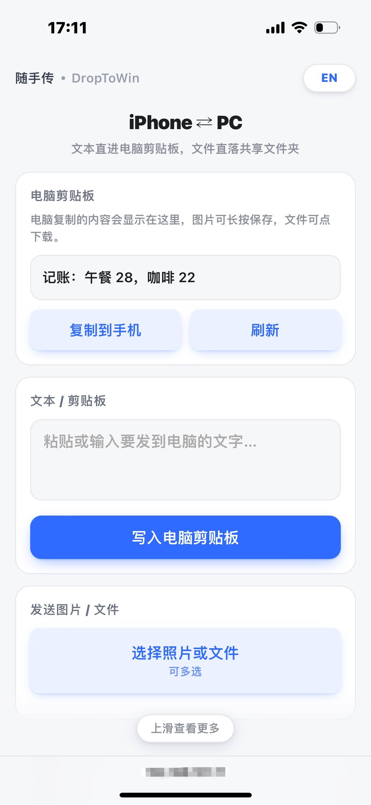
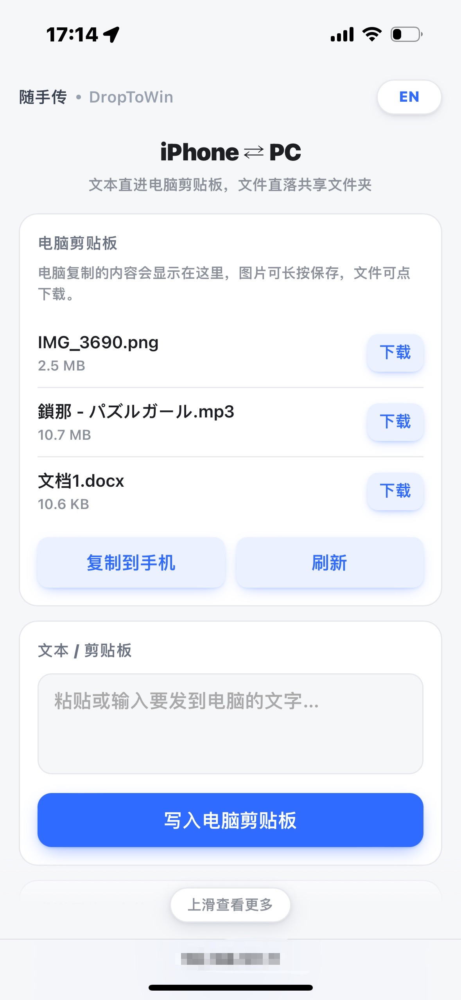
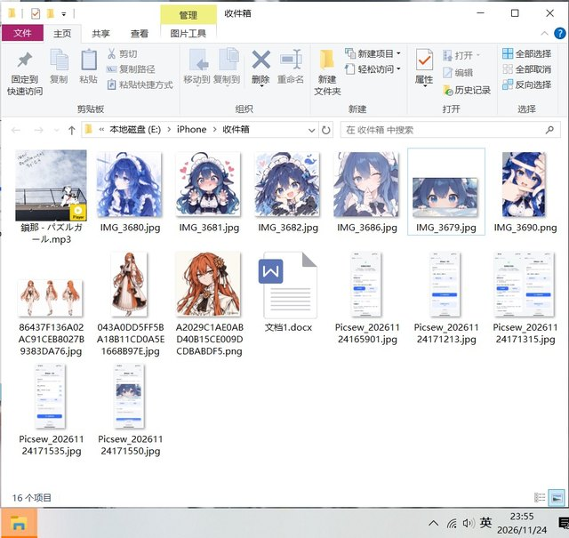

# 随手传 · DropToWin

> 在 iPhone 和 Windows 之间传文件、照片、剪贴板文字。全程走局域网，不经过任何云服务，没有账号，不装手机 App。

[English](README.en.md) · [配置示例](_tools/config.example.json) · v1.0.0

| 手机网页：打开就能收发 | 电脑上复制的文件，手机上直接下载 |
|---|---|
|  |  |



*传到电脑：落进收件箱，自动弹窗定位*

---

## 它解决什么问题

微信传文件要「打开应用 → 找到文件传输助手 → 点加号 → 选文件 → 发送」，五步。
这个工具是「在微信里长按文件 → 分享 → 发到电脑」，三步，而且不用离开你本来就在的地方。

三条主要能力：

| 能力 | 说明 |
|---|---|
| **网页互传** | 手机浏览器打开一个地址就能收发文件、看电脑剪贴板，不用装任何东西 |
| **快捷指令集成** | 从微信 / 相册 / 任意 App 的分享菜单，直接「发到电脑」 |
| **剪贴板双向同步** | 手机复制的文字推到电脑，电脑复制的文字拉到手机；图片和复制的文件也能在手机上查看下载 |

和 LocalSend、Snapdrop 这类工具相比，差异在三点：分享面板直达、剪贴板双向、手机端零安装。

---

## 要求

- **Windows 10 / 11**（剪贴板读写走 Win32 API，仅支持 Windows）
- **Python 3.10 或更高**，安装时勾选 `Add Python to PATH`
- **iPhone + 「快捷指令」App**（系统自带）
- 手机和电脑在**同一个局域网**（同一个路由器，Wi-Fi 或有线都行）

可选依赖（不装也能跑，只是对应功能自动关闭）：

- `Pillow` —— 读电脑剪贴板里的图片。没装就读不到剪贴板图片。
- `pillow-heif` —— 把 iPhone 的 HEIC 照片转成 JPG。没装就原样保留 HEIC 文件（Windows 自带看图打不开）。

```
pip install pillow pillow-heif
```

---

## 安装

1. 下载本项目，解压到任意位置，例如 `D:\iPhone`
2. 双击 `_tools\install.bat`
3. 按提示选一个保存接收文件的文件夹（默认 `D:\iPhone`），等它跑完

安装脚本会自动完成：创建 `收件箱 / 文本 / 发给我` 三个目录、写 `config.json`、放行防火墙 TCP 8899、配置开机自启、启动服务，最后打开一个配置页并显示手机该访问的地址。

| | |
|---|---|
|  | 装完自动打开这个页面：上面是手机该访问的地址，下面两种用法各一段说明。照着做就行，不用记命令。 |

想先看看它要做什么、但不实际改动：

```
install.bat -DryRun
```

安装界面跟随系统语言（中文系统出中文，其余出英文），也可以强制指定：

```
install.bat -Lang en
install.bat -Lang zh
```

---

## 手机上怎么用

### 方式一：网页（装都不用装）

Safari 打开安装完成后显示的地址，例如 `http://192.168.1.10:8899`，然后点底部共享 → **添加到主屏幕**，以后像 App 一样点开。

页面上能做的事：

- 看电脑剪贴板：文字可一键复制，图片可长按存到相册，复制过的文件可逐个下载
- 发文件给电脑：选照片或任意文件
- 下载电脑上的文件：按 `收件箱 / 文本 / 发给我` 分文件夹列出

页面中英双语，默认跟随浏览器语言，右上角可以手动切换。

### 方式二：快捷指令（配一次，之后从分享菜单直接发）

两个快捷指令：

| 名称 | 用途 | 触发方式 |
|---|---|---|
| **发到电脑** | 把文件、照片传到电脑 | 微信长按文件 → 分享 → 发到电脑；相册选图 → 分享 |
| **同步剪贴板** | 双向同步剪贴板 | 手动运行（建议绑到「轻点背面」） |

「同步剪贴板」的判断规则：

| 情况 | 结果 |
|---|---|
| 只有手机复制了新内容 | 推到电脑 |
| 只有电脑复制了新内容 | 拉到手机 |
| 两边都改了 | **以手机为准，推到电脑** |

所以想从电脑拉到手机时，手机上别先复制东西，直接运行即可。被覆盖的内容不会丢，会存进 `文本\` 当天的 md 文件。

| | |
|---|---|
|  | 相册选好照片 → 分享 → **发到电脑**；微信里长按文件走同一条路。装好之后分享面板里就会出现它。 |

配置步骤（配置页里有图文说明，这里简述）：

1. 打开 `http://<电脑IP>:8899/setup`，点两个「添加」按钮，把快捷指令装进手机
2. 打开快捷指令，把里面的 IP 换成配置页显示的那个（只换 IP，`http://` 和 `/api/...` 保持原样）
3. 回到快捷指令首页，长按「发到电脑」→ 详细信息 → 打开「在共享表单中显示」→ 完成
   （不做这步，分享菜单里找不到它）
4. 可选：在分享面板划到底 → 编辑操作 → 给「发到电脑」点绿色加号，把它顶到第一屏

---

## 电脑上怎么用

| 位置 | 内容 |
|---|---|
| `收件箱\` | 手机传来的文件、照片 |
| `文本\` | 推送过来的文字，按日期存成 md |
| `发给我\` | 想让手机下载的文件，丢进来即可 |

收到文件后会弹出一个资源管理器窗口并选中该文件；同一批多张只开一次窗，不刷屏。不想被弹窗打扰，就在 `config.json` 里加 `"open_folder": false`。

---

## 配置文件

`_tools\config.json` 不存在时全部用默认值。存在的字段会覆盖默认：

```json
{
  "base_dir": "D:\\iPhone",
  "port": 8899,
  "heic_to_jpg": true,
  "open_folder": true,
  "shortcuts": [
    {
      "name": "发到电脑",
      "name_en": "Send to PC",
      "url": "https://www.icloud.com/shortcuts/...",
      "url_en": "https://www.icloud.com/shortcuts/...",
      "note": "分享文件、照片到电脑",
      "note_en": "Share files and photos to the PC"
    }
  ]
}
```

| 字段 | 说明 |
|---|---|
| `base_dir` | 数据目录，不填则用「程序目录的上一级」 |
| `port` | 端口，默认 8899 |
| `heic_to_jpg` | HEIC 照片落盘后自动另存一份 JPG，默认 `true`；设 `false` 就只保留 HEIC |
| `open_folder` | 收到文件后自动弹资源管理器并选中文件，默认 `true`；设 `false` 就安静收下 |
| `shortcuts` | 配置页上的安装按钮；`name` 要和手机上中文指令的真实名字一致 |
| `name_en` / `note_en` | 可选的英文文案，不填则沿用中文 |
| `url_en` | 可选的英文版指令链接；配置页切到英文时按钮会指向它，不填则沿用 `url` |

改完 `shortcuts` 需要重启服务（配置只在启动时读一次）。

目录结构：

```
iPhone\
├─ README.md  README.en.md  LICENSE
├─ 收件箱\  文本\  发给我\  ← 数据
└─ _tools\
   ├─ droptowin.py          服务主程序（HTTP + 剪贴板 + 文件落盘）
   ├─ watchdog.py          守护进程，服务挂了自动拉起
   ├─ install.bat          安装入口（双击）
   ├─ install.ps1          安装的实际逻辑（防火墙 / 自启 / 配置）
   ├─ start.vbs            手动启动（无窗口）
   ├─ allow-firewall.bat   单独放行防火墙（备用）
   ├─ config.example.json  参考用，复制成 config.json 再改
   └─ config.json          本机配置（不进仓库）
```

---

## 排错

**手机打不开网页**

1. 确认手机和电脑在同一个局域网，IP 前三段相同
2. 双击 `_tools\start.vbs`，等 15 秒再试
3. 看 `_tools\watchdog.log` 最后几行有没有「服务已恢复」
4. 还不行就检查防火墙，双击 `_tools\allow-firewall.bat`

**传了但电脑没收到**

看 `_tools\access.log` 对应时间有没有 `POST /api/file`：

- 有记录 → 电脑收到了，去 `收件箱\` 找
- 没记录 → 手机没发出去，检查快捷指令里的 IP 是不是变了

**服务起不来**

看 `_tools\droptowin.out`，正常时是空文件，崩溃时这里有真实报错。

**换了 Wi-Fi 或路由器重启后**

IP 可能变化。`ipconfig` 查当前 IPv4 地址，快捷指令和网页地址都要跟着改。
建议在路由器里给这台电脑做 DHCP 绑定，一劳永逸。

**代理软件（Clash 等）开了 TUN / 全局模式**

可能劫持局域网流量导致连不上。在规则里把私有网段放行：

```yaml
rules:
  - IP-CIDR,192.168.0.0/16,DIRECT
  - IP-CIDR,10.0.0.0/8,DIRECT
```

---

## 安全说明

**这个工具没有任何认证，只适合在可信的局域网里用。**

- 服务监听 `0.0.0.0:8899`，同网段内任何设备都能访问，不需要密码
- 家里用自己的 Wi-Fi 没问题；**咖啡馆、酒店、机场等公共网络不要开**
- **不要做端口转发 / 内网穿透**。一旦暴露到公网，等于把收件箱和剪贴板公开
- 传输是明文 HTTP。别用它同步密码、验证码这类内容

---

## 实现细节

```
iPhone Safari / 快捷指令
        │  HTTP（局域网）
        ▼
droptowin.py     ← HTTP 服务 0.0.0.0:8899
        │
        ├─ 写 Windows 剪贴板（ctypes，CF_UNICODETEXT）
        ├─ 读 Windows 剪贴板（文字 / 复制的文件路径 / 图片，图片走 Pillow）
        └─ 文件落盘到 base_dir，顺手按魔数补扩展名、HEIC 转 JPG
```

主要接口：

| 接口 | 方法 | 用途 |
|---|---|---|
| `/` | GET | 手机端网页 |
| `/setup` | GET | 配置向导页 |
| `/api/file?name=` | POST | 上传文件（raw body，支持 chunked） |
| `/api/file64?name=` | POST | 上传文件（Base64 走 JSON） |
| `/api/text` | POST | 文本写入电脑剪贴板 |
| `/api/clipboard` | GET | 读电脑剪贴板（文本 / 图片 / 文件） |
| `/api/clipboard/sync` | POST | 双向同步，返回手机剪贴板应变成的内容 |
| `/api/list` | GET | 按文件夹分组列出共享目录 |
| `/download?path=` | GET | 下载共享目录里的文件 |
| `/clip/img.png` | GET | 电脑剪贴板里的图片 |
| `/clip/file?i=&s=` | GET | 下载电脑剪贴板里复制的文件 |

**为什么用 Base64 传文件**：iOS 快捷指令在「请求体 = 文件」时无法绑定循环项，多文件上传会每次都发同一个文件。改成 Base64 塞进 JSON 字段可以绕开，代价是体积 +33%。

**为什么扩展名要猜**：快捷指令的「名称」属性不含扩展名。服务端读文件头魔数判断真实类型（docx/xlsx/pptx 靠 zip 内部目录、HEIC/JPEG/PNG/PDF 靠头字节），比 Content-Type 可靠。

**为什么 HEIC 要在服务端转 JPG**：微信勾「原图」发出来的 iPhone 照片是 HEIC，到快捷指令手里时类型是「文件」、文件名连扩展名都没有（实测 `name=4281`），指令里根本判断不出来。所以转换放在落盘后：魔数认出 HEIC，就另存一份同名 JPG（按 EXIF 摆正方向、质量 92），原文件保留不删。相册直传的照片快捷指令已经转好，不会重复转。装了 `pillow-heif` 才生效，见上面「可选依赖」。

**为什么页面用不了选中**：`user-select:none` 全局关闭，只放行剪贴板文字、输入框、文件名，避免误触选中整块界面。

---

## 开发

主程序是单文件 `_tools\droptowin.py`，两千行出头：

| 位置 | 内容 |
|---|---|
| 文件头 | 配置读取、路径常量、日志、剪贴板封装 |
| `PAGE` | 手机端互传页面 |
| `SETUP_PAGE` | 配置向导页（含彩纸彩蛋） |
| `Handler` | HTTP 路由与所有接口 |
| `render_setup_page()` | 注入 IP 和快捷指令按钮 |
| `sniff_ext()` / `fix_ext()` | 按文件头魔数补扩展名（docx/xlsx/pptx 还看 zip 目录） |
| `heic_to_jpg()` | HEIC 另存一份 JPG，失败静默 |
| `schedule_alert()` / `_reveal()` | 文件到达提醒与自动开窗 |

页面文案是双语的：`PAGE` 用 JS 词典 `T{key:{zh,en}}`，`SETUP_PAGE` 用 `data-i18n` + 隐藏的英文块。语言优先级：`?lang=` → `localStorage.dtw_lang` → 浏览器语言。

打包成 exe 用 **Nuitka**（不是 PyInstaller —— 后者误报率高，VirusTotal 常见十几个引擎报毒）。脚本里的路径分支同时认 Nuitka 的 `__compiled__` 和 PyInstaller 的 `sys.frozen`：

```cmd
pip install nuitka
python -m nuitka --onefile --windows-console-mode=disable ^
  --include-package=PIL --include-package=pillow_heif ^
  --output-filename=DropToWin.exe droptowin.py
```

产物在 `DropToWin.exe`，数据目录是 exe 所在文件夹的上一级。exe 体积比 PyInstaller 略大，但误报少得多。

---

## License

[MIT](LICENSE)
